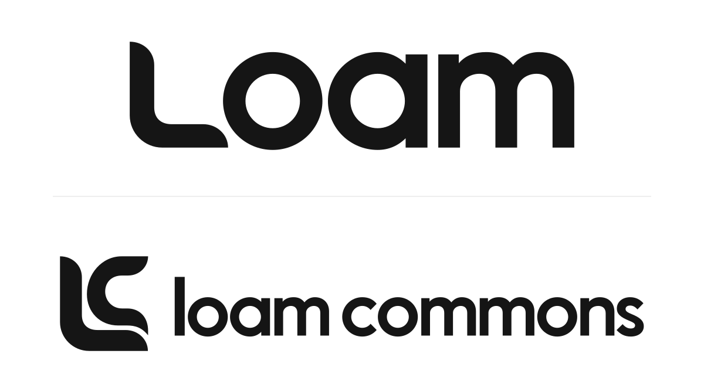

# Loam design system



Canonical identity for [Loam Commons](https://github.com/loamcommons) and [Loam](https://github.com/loamcommons/loam): one shared L, an LC monogram, custom outlined lettering, and reproducible exports.

Loam is the substrate. Commons is the shared work it supports. In the LC mark, the L supports and shelters the nested C while the C opens outward. This is the intended meaning; it is not a claim that every viewer will read the mark that way.

The scope is the visual identity. This repository does not yet define a UI component library, application typography, or a broader product design system.

## Use the identity

- Use the [integrated Loam wordmark](svg/loam-wordmark.svg) for the product: L followed by “oam.”
- Use the [LC monogram](svg/loamcommons-mark-square.svg) or [Loam Commons wordmark](svg/loamcommons-wordmark.svg) for the institution.
- Use the matching `-reverse` export on dark backgrounds. Colors are `#151515` and `#FFFFFF`.
- Keep the included clear space and scale uniformly. The exact coordinates, spacing, and screen minima are in the [construction guide](index.html) and [editable master](source/master.json).
- The [GitHub avatar and social preview](github/) are derived upload canvases. They were applied to the organization and repository on October 18, 2026.

Download or clone the repository, then open `index.html` in a browser. The guide embeds its artwork and needs no server. The separate-symbol Loam arrangement is retained in `comparison/` as evidence of the two-way design comparison; it is not the recommended product wordmark.

The construction guide follows the existing artwork’s monochrome palette and geometric lettering. The original font is unknown. The seven lowercase glyphs are custom outlines for these names, not a general text typeface.

## Source and exports

| Path | Purpose |
| --- | --- |
| `source/master.json` | Authoritative paths, placement, colors, clear space, and minimum sizes |
| `source/` | SVG builder, raster renderer, measurement tools, and finite artifact checks |
| `svg/` | Canonical positive and reverse SVGs |
| `png/` | PNG exports derived from those SVGs |
| `github/` | White-background avatar and social-preview canvases |
| `reference/` | Untouched generated artwork used to identify drift and reconstruct the master |
| `evidence/` | Source hashes, measurements, review summary, comparison plates, and screen specimens |

Define the L once in `source/master.json`. Every standalone mark, monogram, wordmark, and upload canvas derives from that definition. Edit the master and rebuild; editing an exported image does not update the identity.

## Build and check

Python 3.10 or newer builds SVGs without external Python packages. PNG rendering needs `rsvg-convert` from librsvg. The raster audit accepts ImageMagick 7 (`magick`) or ImageMagick 6 (`convert` and `identify`). NumPy is needed only to remeasure the original references.

Check the committed assets without rewriting them:

```sh
python3 source/build.py --check
python3 source/verify.py --check
python3 source/verify_github.py
```

After a deliberate master change, regenerate the full set:

```sh
python3 source/build.py --render
python3 source/verify.py
PYTHONDONTWRITEBYTECODE=1 python3 source/clearance.py
python3 source/final_plate.py
python3 source/overlay.py
python3 source/preview.py
python3 source/guide.py
python3 github/build.py
python3 source/verify_github.py
```

The SVG output is deterministic for the recorded source. PNG bytes may differ between renderer versions; the build manifest records their exact source SVG hashes, and the verification receipt records the rendering tools used. Keep the source-to-export checks and inspect changed screen specimens before merging.

## Evidence and limits

The [artifact audit](evidence/verification.json) checks exact shared paths, serialized placement, closed contours, cubic extrema, declared bounds, PNG dimensions, alpha, opaque colors, clear borders, and source/export hashes. The SVG check also compares the committed files with the current generator. These are finite executable checks, not a machine-checked proof of perception or renderer equivalence.

The [review summary](evidence/review.md) records a three-round Claude Desktop critique and the resulting repairs. Actual-size light and dark screen specimens were inspected. Human recognition, legal distinctiveness, print production, unfamiliar displays, and long-term suitability remain unverified. The standalone L is the least distinctive member of the family; a future application icon needs its own design decision.

## Changes and versions

Use a pull request for changes to the master, rules, or exports. CI verifies the current source and committed artifacts. See [CONTRIBUTING.md](CONTRIBUTING.md) for change boundaries and versioning. Publishing a repository update does not automatically replace assets on other services.

## Licenses

This work is released into the public domain with [CC0 1.0](LICENSE_CC0). Alternatively, it is licensed under [Apache 2.0](LICENSE_A2).

SPDX: `CC0-1.0 OR Apache-2.0`. The usage guidance describes the canonical identity; it does not add restrictions to these licenses.
